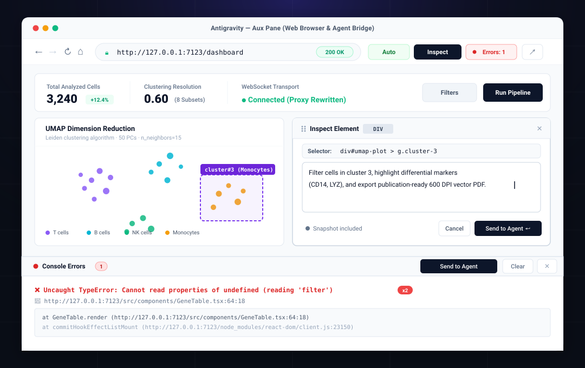

# antigravity-browser

<p align="left">
  <a href="https://github.com/zhonggl951-prog/antigravity-browser/releases"></a>
  <a href="https://github.com/zhonggl951-prog/antigravity-browser/actions/workflows/validate.yml"></a>
  <a href="https://github.com/zhonggl951-prog/antigravity-browser"></a>
  <a href="https://github.com/zhonggl951-prog/antigravity-browser/blob/main/LICENSE"></a>
  <a href="https://github.com/zhonggl951-prog/antigravity-browser/pulls"></a>
  
</p>

An in-IDE web browser and visual element inspector plugin for Google Antigravity's Aux Pane. It allows developers to browse documentation, preview local development servers, select DOM elements, generate visual snapshots, and submit targeted modification prompts directly to their AI agent.

<p align="center">
  
</p>

## Features

- **Aux Pane In-IDE Browsing**: Operates inside Antigravity's auxiliary side panel without occupying or splitting the main editor workspace.
- **Visual Element Inspector (Inspect)**: Hover over any DOM element on the page to highlight its bounding box and CSS selector. Clicking an element opens a prompt dialog that bundles the element's selector, outer HTML snippet, and rendered canvas snapshot into a structured prompt for the agent.
- **Local Reactive App Support**: Built-in WebSocket target rewriting allows local reactive apps (such as R Shiny, Streamlit, Jupyter, and Vite HMR) to maintain persistent WebSocket connections through the sidecar proxy without disconnection errors.
- **Dual Execution Modes**:
  - `🛡️ Proxy`: Routes traffic through the local Node.js proxy with injected DOM inspection and screenshot capabilities.
  - `⚡ Direct`: Loads the URL directly in a native iframe for heavy computational tasks or large file uploads without proxy overhead.
- **Cross-Platform**: Compatible with macOS, Windows 10/11, and Linux. Includes Windows-specific path normalization, curl command routing, and fallback system browser openers.
- **Security Hardening**: Blocks cloud provider metadata endpoints (such as `169.254.169.254`), validates conversation UUIDs against path traversal, and enforces body payload caps.

## Use Cases

- **Click-to-Prompt UI Modification**: Select buttons, cards, or tables on a running local dev server, describe desired UI adjustments, and send the request with visual proof to your coding agent.
- **Local Scientific & Data Apps**: Preview R Shiny dashboards, Streamlit apps, and Gradio tools side-by-side with your analysis scripts.
- **API & Docs Reference**: Browse MDN Web Docs, GitHub repositories, and package documentation without leaving the IDE.

## Installation

Clone this repository into your Antigravity plugins directory:

### macOS / Linux

```bash
git clone https://github.com/zhonggl951-prog/antigravity-browser.git ~/.gemini/config/plugins/browser
```

### Windows (PowerShell)

```powershell
git clone https://github.com/zhonggl951-prog/antigravity-browser.git $env:USERPROFILE\.gemini\config\plugins\browser
```

Validate the installation with the Antigravity CLI:

```bash
agy plugin validate ~/.gemini/config/plugins/browser
```

## Usage

Open the browser sidecar by clicking or outputting its link in an Antigravity conversation:

```markdown
[Web Browser](sidecar://browser/web_browser/ui.html)
```

1. **Browse**: Enter a URL in the address bar (e.g., `https://github.com` or a local port like `http://127.0.0.1:7123`) and press Enter.
2. **Inspect**: Click the `🎯` button in the toolbar to activate inspect mode.
3. **Select**: Hover over the target UI element on the page and click it.
4. **Send to Agent**: Describe the change you want in the modal dialog, then press `Cmd/Ctrl + Enter`. The agent receives the element selector, HTML snippet, and visual snapshot.

## Project Structure

```
antigravity-browser/
├── plugin.json               # Antigravity plugin manifest
├── sidecars/
│   └── web_browser/
│       ├── sidecar.json      # Sidecar entrypoint and view specs
│       ├── server.mjs        # Backend proxy and snapshot storage (Node.js)
│       ├── ui.html           # Aux Pane frontend interface (Light theme)
│       ├── inspector-runtime.js # DOM inspection, canvas capture, and WebSocket routing
│       └── html2canvas.min.js   # Offline canvas rendering engine
├── assets/
│   └── preview.svg           # High-resolution vector preview diagram
├── .github/
│   └── workflows/
│       └── validate.yml      # CI workflow for configuration and syntax checks
├── CONTRIBUTING.md           # Contribution guidelines
├── LICENSE                   # MIT License
└── README.md                 # Project documentation
```

## Requirements

- **Node.js** (v18+)
- **curl** (pre-installed on macOS, Linux, and Windows 10 build 1803+)
- [html2canvas](https://github.com/niklasvh/html2canvas) (included)

## License

[MIT License](LICENSE)
